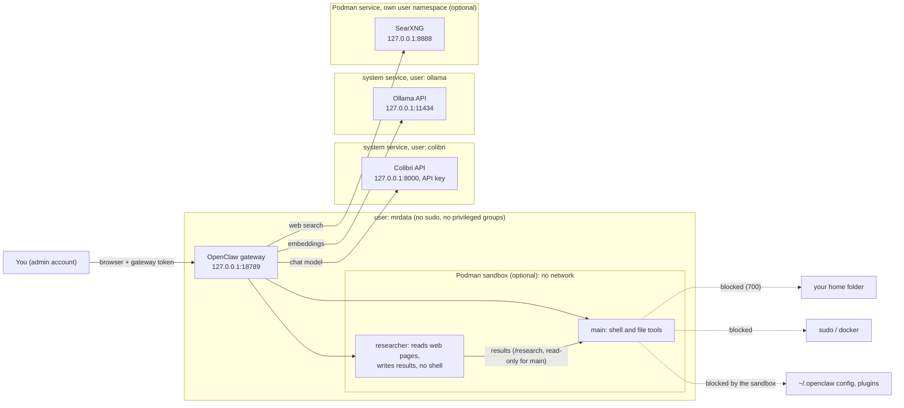

# safe-local-agents

[](https://github.com/macromeer/safe-local-agents/actions/workflows/shellcheck.yml)
[](https://github.com/macromeer/safe-local-agents/actions/workflows/tests.yml)
[](LICENSE)

Run local AI agents ([OpenClaw](https://docs.openclaw.ai)) on local models
([Colibri](https://github.com/JustVugg/colibri), [Ollama](https://ollama.com))
on Linux **without giving them your user account.**

An agent with shell and file tools does whatever your account can do: read
your SSH keys, browser profiles and documents, use `sudo`, talk to Docker. A
prompt injection in a web page or a file it reads is enough to turn that
against you. These scripts give the agents their own locked-down account,
run their tools in a sandbox, split them into one that has a shell and one
that reads the web, give each model server its own system user, and check
that the separation holds.

## How it fits together



| Part | Runs as | Can reach |
|---|---|---|
| OpenClaw gateway | `mrdata`: password locked, no sudo, no privileged groups | its own home, world-readable files, localhost services, the internet |
| The agents' tools | without the sandbox: `mrdata`, like the gateway. With it: a rootless Podman container per agent, inside `mrdata` | with the sandbox, **no network**. `main`: its workspace, the research results (read-only) and the folders you mount. `researcher`: only the results folder |
| Colibri | `colibri` system user, hardened unit | only its model copy in `/var/lib/colibri`; **no network except localhost** |
| Ollama | `ollama` (its official installer already does this) | its models |
| SearXNG | Podman Quadlet with `UserNS=auto`: root in the container is an unused UID on the host | the search engines it asks; listens on loopback only |

## What this protects, and what it doesn't

**Protected:**

- Your home folder: the agent can't read it as long as it is `700`, which `verify.sh` checks.
- Root: the agent has no sudo rules and is not in `wheel`/`sudo`/`docker`/`disk`/… groups.
- The model servers: the agent can't change their code, models or config, and
  can't read the Colibri API key file. Colibri itself can't reach the internet.
- Your session: the gateway listens on loopback only and needs a token.
- OpenClaw's riskiest features: the agent gets the `coding` tool profile, no
  browser control, no elevated exec, and only the plugins you list. These are
  the fixes `openclaw security audit` asks for. See [OpenClaw settings](#openclaw-settings).
- With the [sandbox](#sandbox-for-the-agents-tools): the agent's commands run
  in a container without network, so they can't change its OpenClaw config,
  install plugins, touch its systemd services or open ports. Web pages are
  read by a separate [researcher agent](#two-agents-main-and-researcher)
  without a shell, which can't change its own instructions.
- With [SearXNG](#web-search-with-searxng): web search without an API key or
  account, in a container whose root is not root on your machine.

**Not protected** (know these before you rely on it):

- **The agent can reach the internet** and read world-readable files (`/etc`, `/opt`, `/usr`, …). It can send out anything it can read. The sandbox takes the network away from its commands, but the gateway still has it.
- **It is not a VM.** It shares your kernel; a kernel exploit breaks out. For hostile workloads, use a VM.
- **Without the sandbox, it controls its own setup.** Its commands can edit `~/.openclaw/openclaw.json`, install plugins or replace the gateway, and so undo the settings above.
- **Plugins run inside the gateway, never in the sandbox.** They see every conversation and the keys in its config. Install only plugins you would trust as code running as the agent.
- **Other services on localhost are open to it.** Loopback doesn't separate users: anything on `127.0.0.1` without its own login (dev servers, databases, notebooks) is reachable.
- **Ollama has no authentication.** Any local user, the agent included, can list, pull and delete Ollama models.
- **The agent keeps its key to Colibri** in its own config, so it can use the model directly, which is the point.
- **Anything you share with it is exposed.** If you want it to work on your files, make a separate shared folder; don't open your home folder. See [Sharing files with the agent](#sharing-files-with-the-agent).

## Requirements

- Linux with systemd and `sudo` for your admin account
- Node.js (OpenClaw needs a current version; tested with 24) and npm
- [Colibri](https://github.com/JustVugg/colibri) cloned and built, with a model
  downloaded (`coli setup` does both), for example in `/opt/colibri`
- Optional: Ollama, installed with its official installer (runs as `ollama`),
  with `nomic-embed-text` (`ollama pull nomic-embed-text`) for the agents'
  memory search
- For the sandbox and SearXNG: Podman 4.4 or newer with `catatonit` (both
  come with Fedora Workstation), and no Docker running (see [Your machine](#your-machine-docker-and-the-firewall))

Tested on Fedora 44 with an NVIDIA RTX PRO 4000 (CUDA), OpenClaw 2026.11.6,
Colibri serving Qwen3.6-35B.

## Install

```bash
git clone https://github.com/macromeer/safe-local-agents.git
cd safe-local-agents
cp config.env.example config.env    # optional: change user name, ports, paths
```

Stop any Colibri or OpenClaw you started by hand first. Then, step by step:

```bash
# 1. The agent's account
sudo ./scripts/create-agent-user.sh

# 2. Colibri as a system service (copies the model to /var/lib/colibri)
./scripts/install-colibri-service.sh --print-unit --model ~/colibri-models/qwen36-35b   # review it
sudo ./scripts/install-colibri-service.sh --model ~/colibri-models/qwen36-35b --enable

# 3. OpenClaw for the agent: sets it up for Colibri without questions,
#    applies the hardened settings, installs the gateway
sudo ./scripts/install-openclaw.sh

# 4. Optional: web search with SearXNG
sudo ./scripts/install-searxng.sh

# 5. Optional, recommended: run the agent's tools in a sandbox
sudo ./scripts/install-sandbox.sh

# 6. Check the setup, then test the agents with real model turns
sudo ./scripts/verify.sh
sudo ./scripts/test-agents.sh
```

Every script can be run again; it only fixes what isn't right yet. Each one has `--help`.
They refuse settings that point at the wrong account (`AGENT_USER` or
`COLIBRI_USER` set to root, to your own account or to a system account),
and they refuse to run if the agent user can change this checkout, since
they run its code as root. Clone it as your own account, outside the
agent's reach.

If your own account used OpenClaw before, remove it there once the agent works:
`npm uninstall -g openclaw` and delete `~/.openclaw` (it holds a gateway token).
After step 2 you can delete the original model folder: the service has its own copy.

## Using the agent

Open `http://127.0.0.1:18789` and log in with the token:

```bash
sudo -iu mrdata openclaw gateway auth-token --show
```

There are two agents: `main` (the default, with a shell) and `researcher`
(reads web pages, no shell); switch between them in the dashboard's agent
picker. See [Two agents](#two-agents-main-and-researcher).

To work as the agent user in a terminal, `systemctl --user` needs two extra variables, because `sudo -iu` doesn't connect to its systemd:

```bash
sudo -iu mrdata
export XDG_RUNTIME_DIR=/run/user/$(id -u)
export DBUS_SESSION_BUS_ADDRESS=unix:path=$XDG_RUNTIME_DIR/bus
openclaw gateway status
```

## Sharing files with the agent

The agent can only use what its own account (`mrdata`) can read. Keep your
home folder at `700`, and share folders outside it instead.

Before you share anything:

- **It can send out anything it can read**, because it has internet access.
  Only share what you could live with leaking through a prompt injection.
- **It can delete anything it can write.** Share read-only unless it really
  needs to write, give it a separate folder for its output, and keep backups.

### Share a folder

ACLs grant access to one user and take effect right away, without logging in
again. Run these as your admin account:

```bash
sudo mkdir -p /srv/agent-share
sudo chown "$USER": /srv/agent-share

# Read-only: the files there now, and files you add later
setfacl -R -m u:mrdata:rX /srv/agent-share
setfacl -d -m u:mrdata:rX /srv/agent-share

# Read-write, for a folder where it saves its output.
# The d: entries keep new files editable by both of you.
mkdir -p /srv/agent-share/out
setfacl -R -m u:mrdata:rwX,d:u:mrdata:rwX,d:u:"$USER":rwX /srv/agent-share/out
```

Check what the agent can reach with `getfacl /srv/agent-share`, or
`sudo -u mrdata ls /srv/agent-share`.

If the folder has to stay inside your home, bind-mount only that folder
instead of opening your home:

```bash
sudo mkdir -p /srv/agent-share/thesis
sudo mount --bind ~/Documents/thesis /srv/agent-share/thesis
```

Then apply the ACLs above to `/srv/agent-share/thesis`. To keep the mount after
a reboot, add this line to `/etc/fstab` (leave out `,ro` if it should write):

```
/home/you/Documents/thesis  /srv/agent-share/thesis  none  bind,ro  0 0
```

To stop sharing a folder, remove its ACL entries with
`setfacl -R -x u:mrdata,d:u:mrdata /srv/agent-share`, and unmount any bind
mounts.

With the [sandbox](#sandbox-for-the-agents-tools), the agent's commands only
see the folders that are also listed in `SANDBOX_BINDS`.

### Give it files to learn from

The agent doesn't train on your files. It either **reads them when you ask**
("summarise /srv/agent-share/report.pdf"), or **indexes them for memory
search** so it can find them later by meaning. Memory search only indexes
Markdown by default, so convert PDFs and documents to `.md` for that.

**One-off notes:** copy them into its memory folder. It can't read your home,
so copy as root and hand them over:

```bash
sudo cp -r ~/notes/projectX /home/mrdata/.openclaw/workspace/memory/
sudo chown -R mrdata:mrdata /home/mrdata/.openclaw/workspace/memory/projectX
sudo -iu mrdata openclaw memory index --force
```

**Files that keep changing:** leave them in a shared folder and add it to the
index. `openclaw config set` checks the value against OpenClaw's schema:

```bash
sudo -iu mrdata openclaw config set memory.search.extraPaths \
  '[{"path": "/srv/agent-share/docs", "pattern": "**/*.md"}]' --strict-json
sudo -iu mrdata openclaw memory index --force
sudo -iu mrdata openclaw memory status
```

This applies to both agents and adds to `main`'s own entry for the research
results. Use the real path, not a symlink, because the indexer skips
symlinks. The gateway does the indexing, outside the sandbox, so the folder
doesn't need to be in `SANDBOX_BINDS` for this. If you edit
`openclaw.json` by hand, keep it plain JSON (no comments, quoted keys):
`install-openclaw.sh --key-only` reads it with a strict JSON parser.

## Security settings

### OpenClaw settings

`install-openclaw.sh` sets these in the agent's config, which is what
`openclaw security audit` recommends for an agent with tools:

| Setting | Value | Why |
|---|---|---|
| `tools.profile` | `coding` | shell, files, web search, memory and sessions, but not the browser or plugin-owned tools (onboarding sets `full`: everything) |
| `browser.enabled` | `false` | web pages are the usual way in for prompt injection |
| `tools.elevated.enabled` | `false` | elevated exec runs commands outside the sandbox. It also turns off the `!` shell commands in chat |
| `plugins.allow` | `OPENCLAW_PLUGINS`, if empty | every plugin is code inside the gateway. A fresh config enables 44 bundled ones; this keeps `document-extract`, `web-readability` and `ollama`, plus `memory-core`, which loads anyway |

`OPENCLAW_HARDEN=no` in `config.env` leaves them to you. An existing
`plugins.allow` is never overwritten. To apply them to an install that
already exists: `sudo ./scripts/install-openclaw.sh --harden-only`. To see
what loads: `sudo -iu mrdata openclaw plugins list --enabled`. After you
change anything, run `sudo -iu mrdata openclaw security audit --deep`. Its
`gateway.trusted_proxies_missing` warning only matters behind a reverse
proxy, so you can ignore it.

### Web search with SearXNG

```bash
sudo ./scripts/install-searxng.sh
```

[SearXNG](https://docs.searxng.org/) is a self-hosted search engine that asks
Google, Bing, DuckDuckGo and others for you, without an API key or account.
The script:

- writes `/etc/searxng-agent/settings.yml` with a random secret, the JSON
  format OpenClaw needs, and no rate limiter or image proxy
- installs a Podman Quadlet (`systemd/searxng.container.in` →
  `/etc/containers/systemd/searxng.container`) that starts at boot, listens
  on `127.0.0.1:8888` only, and runs with `UserNS=auto`
- installs OpenClaw's official `searxng` plugin for the agent, pinned to
  `OPENCLAW_VERSION`, and makes it the agent's web search

Why it runs this way: SearXNG reads untrusted web content all day. Under
rootful Docker, root in the container is root on your machine. With
`UserNS=auto` it is an unused high UID that owns nothing (`verify.sh`
checks this). It also shouldn't run as `mrdata`: the agent shouldn't
control the service it gets its information from.

Your searches still go to the search engines, from your IP address, just
without an account. The search results are untrusted text for the agent,
like any web content.

### Sandbox for the agent's tools

Without a sandbox, the agent's commands run as `mrdata`, the same user as the
gateway, so they can rewrite its config, install plugins or replace the
gateway. OpenClaw can run tools in a container instead, and the gateway
stays outside it:

```bash
sudo ./scripts/install-sandbox.sh
```

The script gives `mrdata` subordinate UIDs (rootless Podman needs them),
builds the image `openclaw-sandbox:trixie-slim` as `mrdata`, sets up the
[two agents](#two-agents-main-and-researcher), and sets:

- `agents.defaults.sandbox.mode: "all"` with backend `podman`: every session runs in the sandbox
- no network, a read-only root with `tmpfs` for `/tmp`, all capabilities
  dropped, and the agent's own UID in the container, so it gets exactly
  `mrdata`'s file permissions
- `tools.elevated.enabled: false`

`main`'s container sees its workspace at `/workspace` and the folders in
`SANDBOX_BINDS`, but not `~/.openclaw`, the systemd user manager or the
Podman socket (the researcher's is narrower, see below). OpenClaw blocks its `gateway`, `cron`, `nodes` and
`automations` tools in sandboxed sessions, because they act from outside
the sandbox. `verify.sh` reads `openclaw sandbox explain` and fails if any
of them, or elevated exec, is let back in.

| Setting | Default | |
|---|---|---|
| `SANDBOX_NETWORK` | `none` | `bridge` gives commands internet access, for `git clone`, `pip install`, … |
| `SANDBOX_WORKSPACE` | `rw` | `ro` or `none` to keep the agent's workspace out |
| `SANDBOX_BINDS` | empty | extra folders, e.g. `"/srv/agent-share:/share:ro /srv/agent-share/out:/out:rw"`. `mrdata` needs access to them as in [Share a folder](#share-a-folder). Not over `/run`: Podman's init lives there. They are mounted into both agents' sandboxes, so mount writable folders with care. Setting any turns on OpenClaw's `dangerouslyAllowExternalBindSources` for all sandboxes, which folders outside a workspace need |
| `SANDBOX_GATEWAY_TOOLS` | `web_search memory_search memory_get` | tools that run in the gateway but that `main` may use from the sandbox. OpenClaw's sandbox allows none by default. Adding `web_fetch` lets `main` read pages itself instead of through the researcher. `*`, groups and `gateway`/`cron`/`nodes`/`automations` are refused |

Change a setting in `config.env`, then run the script again. To turn the
sandbox off: `sudo ./scripts/install-sandbox.sh --off` (the agents stay).

The gateway, plugins and the tools in `SANDBOX_GATEWAY_TOOLS` stay outside
the sandbox. That is a deliberate gap: a hijacked agent can put data into
search queries, which go to the search engines. The image has no Node.js;
if the agent needs it, build your own image as OpenClaw's sandbox docs
describe.

`verify.sh` reads the settings through `openclaw sandbox explain` for both
agents, and starts a throwaway container from the sandbox image as `mrdata`
(UID, no network). It can't start a sandbox through OpenClaw itself, so run
`sudo ./scripts/test-agents.sh` after every change (see [Test the sandbox](#test-the-sandbox)).

#### Two agents: main and researcher

Reading web pages is the usual way in for prompt injection, and an agent
with a shell is the one you least want injected. So there are two agents,
both in the sandbox and on the same model (no second model on the GPU):

| | `main` (the default) | `researcher` |
|---|---|---|
| Shell | yes | no |
| Writes files | its workspace | only the results folder, `/home/mrdata/research` |
| `web_search` | yes | yes |
| `web_fetch` (read any page) | no | yes |
| Research results | reads them: at `/research` (read-only) and through memory search | writes them |
| Can change its own instructions | yes | no: its workspace isn't in its sandbox |

The flow:

1. Pick `researcher` in the dashboard's agent picker and ask it to research
   something. It saves the brief as
   `/home/mrdata/research/YYYY-MM-DD-HHMM-<topic>.md` (question, date,
   summary, sources) and answers with the file name and a short summary.
2. Back in `main`, ask about it (*what did the researcher find about X?*).
   `main` finds the file through its memory search, which marks such hits
   as untrusted, or reads `/research/` directly.

You start the research yourself because `main` can't: OpenClaw won't let a
sandboxed agent hand `web_fetch` to an agent it starts (`delegateToolsTo`
needs a requester without allowlists, and the sandbox always has one).
`main`'s instructions tell it to say so and suggest a question for the
researcher, instead of working around it.

Why the researcher's sandbox has no workspace of its own: OpenClaw can only
limit write tools to a whole workspace. If the researcher's workspace were in
its sandbox, a web page that hijacks it could rewrite its `AGENTS.md`, or add
a skill (workspace skills win over all others), and every later research
would follow the injected instructions. So it runs with
`workspaceAccess: "none"`: OpenClaw gives it an isolated scratch workspace,
and the only real folder in its sandbox is the results folder, mounted at
`/workspace/results` (inside `/workspace`, because OpenClaw's write tools
stay within it). OpenClaw reserves `/workspace` for its own mounts, so this
one bind needs `dangerouslyAllowReservedContainerTargets` (researcher only);
the script refuses any target that would hide OpenClaw's own paths
(`/workspace` itself, `skills/`, `.agents/`, `.openclaw/`). With SELinux on
(Fedora), containers can't use files labelled `user_home_t` and Podman
doesn't relabel these mounts, so the script adds a permanent rule that
labels the results folder `container_file_t` (`semanage fcontext`;
`uninstall.sh --agent-user` removes it). Its own workspace, `~/.openclaw/workspace-researcher` with
its `AGENTS.md`, is only read by the gateway. `RESEARCH_DIR` in `config.env`
moves the results folder; it must be outside `~/.openclaw`, which the script
never mounts.

OpenClaw only mounts a folder from outside an agent's own workspace with
`sandbox.docker.dangerouslyAllowExternalBindSources: true`, so the script
sets that for these two agents only (and for all of them only when
`SANDBOX_BINDS` is set). OpenClaw's other bind checks stay: no system paths,
credential folders (`~/.ssh`, `~/.config`, …), sockets or symlink tricks.

Both agents also get security instructions in their `AGENTS.md`, from
[`agent-instructions/`](agent-instructions/), between
`safe-local-agents:security` markers that the script replaces on each run.
The researcher treats everything it reads as data, refuses instructions from
pages, and puts `⚠ Possible prompt injection: <URL> asked me to <what>` at
the top of its result. `main` treats results as untrusted and asks you
before it runs commands or changes files because of one, or when a result
carries that warning.

What this does not stop: instructions are not a boundary. A clever
injection can talk a model out of them, local models more easily. If one
works on the researcher, it can leak what is in that conversation (through
the URLs it fetches) and write misleading results; it has no shell, can't
change its instructions, and can't see `main`'s files. If a result misleads
`main`, `main` is still in the sandbox: no network, no config, at worst
damage in its workspace.

#### Test the sandbox

`verify.sh` checks the settings. `sudo ./scripts/test-agents.sh` checks that
they work: it runs the tests below as real turns through the gateway (same
sandbox and tools as the dashboard, a few minutes, uses the model) and
judges what happened, not what the model says: the gateway token and Colibri
key must not appear in a reply, test files must exist, tool lists must
(not) contain `web_search`, `web_fetch` or `exec`, and the researcher's
`AGENTS.md` must keep its checksum. It removes its test sessions and files.
`UNCLEAR` means the model's reply didn't allow a verdict; try that test in
the dashboard. By hand, in the dashboard:

1. ask `main` to run `cat /home/mrdata/.openclaw/openclaw.json`: **must fail** (not in the sandbox)
2. ask `main` to run `curl -sI https://example.com`: **must fail** with `SANDBOX_NETWORK=none`
3. ask `main` to create, edit and read a file in its workspace: must work
4. ask `main` to search the web: must work (runs in the gateway)
5. pick `researcher`, ask it to research a topic: must save `/home/mrdata/research/<date>-<topic>.md`;
   then ask `main` what the researcher found about it: must find and cite that file
6. ask `researcher` to run a command: **must fail**. Ask it to add a line to
   its `AGENTS.md`: it may say it did, but only changes a copy in its scratch
   workspace; the real `~/.openclaw/workspace-researcher/AGENTS.md` **must be
   unchanged** (`sudo tail -3 /home/mrdata/.openclaw/workspace-researcher/AGENTS.md`)

### Your machine: Docker and the firewall

Two settings outside the agent's account that the scripts check but don't change:

- **Docker.** Being in the `docker` group gives root without a password to
  anything running as you. Docker also sets the kernel's `FORWARD` policy to
  `DROP`, which cuts Podman's containers (SearXNG, the sandbox) off from the
  internet until a reboot. If you don't need Docker: `sudo systemctl disable --now docker.service docker.socket`,
  `sudo gpasswd -d $USER docker`, reboot. Podman does the same job without a
  root daemon.
- **Firewall.** Fedora Workstation's default zone accepts incoming
  connections on ports 1025–65535, so your network can reach any port the
  agent opens. If nothing on your network needs that:
  ```bash
  sudo firewall-cmd --permanent --zone=FedoraWorkstation --remove-port=1025-65535/tcp --remove-port=1025-65535/udp
  sudo firewall-cmd --reload
  ```
  SSH, Samba client and DHCPv6 stay allowed. `verify.sh` warns about wide
  port ranges in any active zone.

## What the scripts do

| Script | Does |
|---|---|
| `create-agent-user.sh` | Creates the user, locks its password, removes it from privileged groups, sets its home to `700`, fails if sudo grants it anything, enables linger, warns about home folders other users can read |
| `install-colibri-service.sh` | Creates the `colibri` system user, copies the model to `/var/lib/colibri/models` (reflink on btrfs/XFS: instant, no extra space), generates an API key in `/etc/colibri/colibri.env` (`root:colibri 640`), installs the hardened unit from `systemd/colibri.service.in` |
| `install-openclaw.sh` | Installs a pinned OpenClaw into the agent's `~/.local` and sets it up without questions (`openclaw onboard --non-interactive`): Colibri as the model provider `colibri` with the first model it lists (`COLIBRI_MODEL_ID` to choose), its key through stdin (never on a command line), the gateway on loopback with a token, and memory search with Ollama's `nomic-embed-text` if it is there. Then the [hardened settings](#openclaw-settings) and the gateway as a systemd user service. An existing config is kept; `--interactive` runs OpenClaw's own wizard instead |
| `install-searxng.sh` | Writes the SearXNG settings, installs and starts the Quadlet from `systemd/searxng.container.in`, checks that it answers, installs OpenClaw's `searxng` plugin and makes it the agent's web search |
| `install-sandbox.sh` | Gives the agent subordinate UIDs, builds the sandbox image as the agent, sets OpenClaw to run every session's tools in it, turns elevated exec off, creates the `researcher` agent (replacing an older `reader`) with no workspace of its own in its sandbox, mounts the results folder into both sandboxes (read-write for the researcher, read-only for `main`) and into `main`'s memory search, writes the security instructions into both `AGENTS.md`, recreates the sandboxes, and shows what `openclaw sandbox explain` reports for both agents. `--off` turns the sandbox off |
| `test-agents.sh` | Runs six tests through both agents with real model turns (config not visible, no network, writing, web search, researcher results found by `main`, researcher without shell and unable to change its instructions) and checks files, tool lists and checksums. Exits 1 if one fails |
| `verify.sh` | Read-only check of all of the above: separation, model servers, the OpenClaw settings and sandbox (through `openclaw sandbox explain`, plus a test container), both agents' tools and mounts, the results folder's SELinux label, SearXNG's port and user namespace, Docker and the firewall. Exits 1 on any failure. Works without root, with fewer checks |
| `uninstall.sh` | Removes the gateway, the Colibri service (`--purge-colibri` also deletes its data and user), the SearXNG Quadlet, or the agent user with its home (and the SELinux rule for the results folder), one option at a time |

Settings are in [`config.env.example`](config.env.example).

## Day to day

```bash
journalctl -u colibri -f                                  # model server log
sudo systemctl restart colibri
sudo -iu mrdata openclaw gateway status
sudo ./scripts/install-openclaw.sh --key-only             # after changing the Colibri key
```

**Update OpenClaw:** set `OPENCLAW_VERSION` in `config.env`, then `sudo ./scripts/install-openclaw.sh --skip-onboard`. The SearXNG plugin follows OpenClaw's versions: `sudo -iu mrdata openclaw plugins update @openclaw/searxng-plugin@<version>`. Then run `sudo ./scripts/install-sandbox.sh` (it recreates the sandboxes), `verify.sh` and `test-agents.sh`.

**Add the [ponytail](https://github.com/DietrichGebert/ponytail) coding skills:** set `PONYTAIL=yes` in `config.env`, then `sudo ./scripts/install-openclaw.sh --skip-onboard`. They are Markdown instructions, pinned to a commit in `PONYTAIL_REF`, and show up in OpenClaw as `/ponytail`, `/ponytail-review` and so on. To remove them: `sudo -iu mrdata rm -r ~/.openclaw/skills/ponytail*`.

**Update Colibri:** `git pull` and rebuild in `/opt/colibri`, then `sudo systemctl restart colibri`.

**Update SearXNG:** look up the digest of a newer `searxng/searxng` image, set it as `SEARXNG_IMAGE` in `config.env`, then `sudo ./scripts/install-searxng.sh`. Its log: `journalctl -u searxng -f`.

**After updating OpenClaw**, also check its own view of the setup: `sudo -iu mrdata openclaw security audit --deep` and `sudo -iu mrdata openclaw sandbox explain --agent main`.

## Troubleshooting

| Problem | Fix |
|---|---|
| `systemctl --user`: *Failed to connect to bus* | Export `XDG_RUNTIME_DIR` and `DBUS_SESSION_BUS_ADDRESS` (see above) |
| Colibri doesn't find the GPU | One of the hardening lines blocks it. In the unit, comment out `RestrictNamespaces` first, then `ProtectKernelTunables` |
| OpenClaw gets `401` from Colibri | The key in its config is missing or old: `sudo ./scripts/install-openclaw.sh --key-only` |
| `port 8000 is already in use` | A Colibri you started by hand is still running: Ctrl+C it or `coli stop` |
| Gateway stops when you log out | Linger is off: `sudo loginctl enable-linger mrdata` |
| SearXNG restarts over and over, its log shows `TimeoutError` at start | It can't reach the internet. Usually Docker's firewall rules: disable Docker and reboot (see [Your machine](#your-machine-docker-and-the-firewall)) |
| OpenClaw's searches get `403` from SearXNG | JSON is off: `search.formats: [html, json]` in `/etc/searxng-agent/settings.yml`, then `sudo systemctl restart searxng` |
| Sandboxed commands fail with *Disk quota exceeded* | Rootless Podman ran out of kernel keys: `sudo sysctl -w kernel.keys.maxkeys=2000 kernel.keys.maxbytes=200000` (and put both in `/etc/sysctl.d/`) |
| `install-sandbox.sh` stops: `/home/mrdata/research` still holds an old researcher workspace | Left by an earlier version. `sudo chattr -R -i /home/mrdata/research`, then `sudo -iu mrdata openclaw agents delete researcher --force`; if OpenClaw doesn't know the agent any more, move the folder away (`sudo mv /home/mrdata/research /home/mrdata/research.old`) |
| Creating `researcher` fails: deletion cleanup is still pending | An earlier deletion couldn't finish. Run `sudo -iu mrdata openclaw agents delete researcher --force` again, or `sudo -iu mrdata openclaw doctor --fix` |
| The researcher can't save results: `PermissionError: [Errno 13] Permission denied: '/workspace/results'` | SELinux: the results folder lacks the `container_file_t` label. Run `sudo ./scripts/install-sandbox.sh` again; check with `ls -Zd /home/mrdata/research` |
| Sandboxed tools can't write in the workspace | The container user isn't the agent's UID: run `sudo ./scripts/install-sandbox.sh` again (it recreates the sandboxes; `openclaw sandbox recreate` only works with the gateway stopped) |
| *Sandbox security: bind mount … is outside allowed roots* or *… targets reserved container path* | OpenClaw refuses mounts from outside a workspace, or into `/workspace`, without an override. `install-sandbox.sh` sets the overrides for its own mounts and for `SANDBOX_BINDS`; mounts added by hand need them too (see [Two agents](#two-agents-main-and-researcher)) |

## Tests

- `python3 -m unittest discover -s tests`: unit tests, safe to run anywhere.
  They cover `lib/openclaw_config.py`, partly with real output from OpenClaw
  2026.11.6 (`sandbox explain`, `agent --json`).
- `sudo ./scripts/test-agents.sh`: on an installed machine, six tests through
  both agents with real model turns (see [Test the sandbox](#test-the-sandbox)).
- `tests/integration.sh`: runs `create-agent-user.sh`, then breaks the agent's
  separation on purpose (sudo rule, `sudo` group, open home, password, linger,
  a listener on all interfaces) and checks that `verify.sh` reports each break
  and `create-agent-user.sh` repairs it. It grants a test user sudo rights
  along the way, so it only runs in CI (GitHub Actions, on a throwaway VM).

## Security issues

Found a way around the separation? Please report it privately, not as an
issue: see [SECURITY.md](SECURITY.md).

## License

[MIT](LICENSE)
