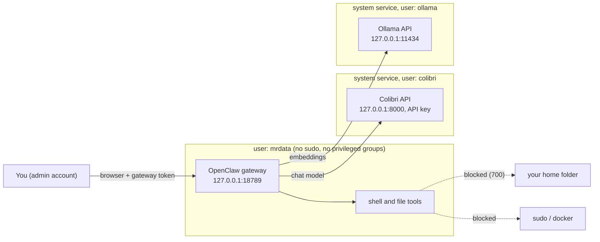

# safe-local-agent

[](https://github.com/macromeer/safe-local-agent/actions/workflows/shellcheck.yml)
[](https://github.com/macromeer/safe-local-agent/actions/workflows/tests.yml)
[](LICENSE)

Run a local AI agent ([OpenClaw](https://docs.openclaw.ai)) on local models
([Colibri](https://github.com/JustVugg/colibri), [Ollama](https://ollama.com))
on Linux **without giving it your user account.**

An agent with shell and file tools does whatever your account can do: read
your SSH keys, browser profiles and documents, use `sudo`, talk to Docker. A
prompt injection in a web page or a file it reads is enough to turn that
against you. These scripts give the agent its own locked-down account, give
each model server its own system user, and check that the separation holds.

## How it fits together



| Part | Runs as | Can reach |
|---|---|---|
| OpenClaw gateway and its tools | `mrdata`: password locked, no sudo, no privileged groups | its own home, world-readable files, localhost services, the internet |
| Colibri | `colibri` system user, hardened unit | only its model copy in `/var/lib/colibri`; **no network except localhost** |
| Ollama | `ollama` (its official installer already does this) | its models |

## What this protects, and what it doesn't

**Protected:**

- Your home folder: the agent can't read it as long as it is `700`, which `verify.sh` checks.
- Root: the agent has no sudo rules and is not in `wheel`/`sudo`/`docker`/`disk`/… groups.
- The model servers: the agent can't change their code, models or config, and
  can't read the Colibri API key file. Colibri itself can't reach the internet.
- Your session: the gateway listens on loopback only and needs a token.

**Not protected** (know these before you rely on it):

- **The agent can reach the internet** and read world-readable files (`/etc`, `/opt`, `/usr`, …). It can send out anything it can read.
- **It is not a VM or a container.** It shares your kernel; a kernel exploit breaks out. For hostile workloads, use a VM.
- **Ollama has no authentication.** Any local user, the agent included, can list, pull and delete Ollama models.
- **The agent keeps its key to Colibri** in its own config, so it can use the model directly, which is the point.
- **Anything you share with it is exposed.** If you want it to work on your files, make a separate shared folder; don't open your home folder.

## Requirements

- Linux with systemd and `sudo` for your admin account
- Node.js (OpenClaw needs a current version; tested with 24) and npm
- [Colibri](https://github.com/JustVugg/colibri) cloned and built, with a model
  downloaded (`coli setup` does both), for example in `/opt/colibri`
- Optional: Ollama, installed with its official installer (runs as `ollama`)

Tested on Fedora 44 with an NVIDIA RTX PRO 4000 (CUDA), OpenClaw 2026.11.6,
Colibri serving Qwen3.6-35B.

## Install

```bash
git clone https://github.com/macromeer/safe-local-agent.git
cd safe-local-agent
cp config.env.example config.env    # optional: change user name, ports, paths
```

Stop any Colibri or OpenClaw you started by hand first. Then, step by step:

```bash
# 1. The agent's account
sudo ./scripts/create-agent-user.sh

# 2. Colibri as a system service (copies the model to /var/lib/colibri)
./scripts/install-colibri-service.sh --print-unit --model ~/colibri-models/qwen36-35b   # review it
sudo ./scripts/install-colibri-service.sh --model ~/colibri-models/qwen36-35b --enable

# 3. OpenClaw for the agent (runs its setup wizard, then installs the gateway)
sudo ./scripts/install-openclaw.sh

# 4. Check
sudo ./scripts/verify.sh
```

Every script can be run again; it only fixes what isn't right yet. Each one has `--help`.

If your own account used OpenClaw before, remove it there once the agent works:
`npm uninstall -g openclaw` and delete `~/.openclaw` (it holds a gateway token).
After step 2 you can delete the original model folder: the service has its own copy.

## Using the agent

Open `http://127.0.0.1:18789` and log in with the token:

```bash
sudo -iu mrdata openclaw gateway auth-token --show
```

To work as the agent user in a terminal, `systemctl --user` needs two extra variables, because `sudo -iu` doesn't connect to its systemd:

```bash
sudo -iu mrdata
export XDG_RUNTIME_DIR=/run/user/$(id -u)
export DBUS_SESSION_BUS_ADDRESS=unix:path=$XDG_RUNTIME_DIR/bus
openclaw gateway status
```

## What the scripts do

| Script | Does |
|---|---|
| `create-agent-user.sh` | Creates the user, locks its password, removes it from privileged groups, sets its home to `700`, fails if sudo grants it anything, enables linger, warns about home folders other users can read |
| `install-colibri-service.sh` | Creates the `colibri` system user, copies the model to `/var/lib/colibri/models` (reflink on btrfs/XFS: instant, no extra space), generates an API key in `/etc/colibri/colibri.env` (`root:colibri 640`), installs the hardened unit from `systemd/colibri.service.in` |
| `install-openclaw.sh` | Installs a pinned OpenClaw into the agent's `~/.local`, runs `openclaw onboard` with the values you need printed, writes the Colibri key into its config (through stdin, never on a command line), installs the gateway as a systemd user service |
| `verify.sh` | Read-only check of all of the above and of what the agent can reach. Exits 1 on any failure. Works without root, with fewer checks |
| `uninstall.sh` | Removes the gateway, the Colibri service (`--purge-colibri` also deletes its data and user) or the agent user, one option at a time |

Settings are in [`config.env.example`](config.env.example).

## Day to day

```bash
journalctl -u colibri -f                                  # model server log
sudo systemctl restart colibri
sudo -iu mrdata openclaw gateway status
sudo ./scripts/install-openclaw.sh --key-only             # after changing the Colibri key
```

**Update OpenClaw:** set `OPENCLAW_VERSION` in `config.env`, then `sudo ./scripts/install-openclaw.sh --skip-onboard`.

**Add the [ponytail](https://github.com/DietrichGebert/ponytail) coding skills:** set `PONYTAIL=yes` in `config.env`, then `sudo ./scripts/install-openclaw.sh --skip-onboard`. They are Markdown instructions, pinned to a commit in `PONYTAIL_REF`, and show up in OpenClaw as `/ponytail`, `/ponytail-review` and so on. To remove them: `sudo -iu mrdata rm -r ~/.openclaw/skills/ponytail*`.

**Update Colibri:** `git pull` and rebuild in `/opt/colibri`, then `sudo systemctl restart colibri`.

## Troubleshooting

| Problem | Fix |
|---|---|
| `systemctl --user`: *Failed to connect to bus* | Export `XDG_RUNTIME_DIR` and `DBUS_SESSION_BUS_ADDRESS` (see above) |
| Colibri doesn't find the GPU | One of the hardening lines blocks it. In the unit, comment out `RestrictNamespaces` first, then `ProtectKernelTunables` |
| OpenClaw gets `401` from Colibri | The key in its config is missing or old: `sudo ./scripts/install-openclaw.sh --key-only` |
| `port 8000 is already in use` | A Colibri you started by hand is still running: Ctrl+C it or `coli stop` |
| Gateway stops when you log out | Linger is off: `sudo loginctl enable-linger mrdata` |

## Tests

- `python3 -m unittest discover -s tests`: unit tests, safe to run anywhere.
- `tests/integration.sh`: runs `create-agent-user.sh`, then breaks the agent's
  separation on purpose (sudo rule, `sudo` group, open home, password, linger,
  a listener on all interfaces) and checks that `verify.sh` reports each break
  and `create-agent-user.sh` repairs it. It grants a test user sudo rights
  along the way, so it only runs in CI (GitHub Actions, on a throwaway VM).

## License

[MIT](LICENSE)
